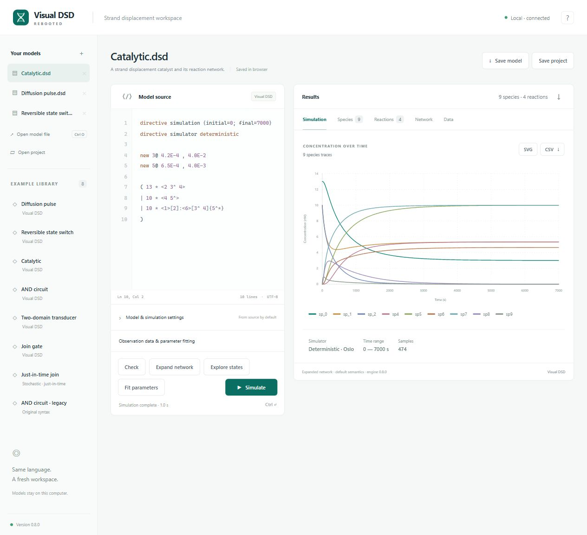

<div align="center">


# Visual DSD Rebooted

**DNA strand displacement modelling. Familiar syntax. A modern local workspace.**

[](https://github.com/parhamKIY/Visual-DSD-rebooted/actions/workflows/engine.yml) [](global.json) [](LICENSE)

[Get the app](#get-the-app) · [Try a model](#try-a-model) · [Command line](#command-line) · [Build & test](#build--test) · [Compatibility](#compatibility--scope)

</div>

Visual DSD Rebooted brings the Visual DSD language and its F# scientific core into a current .NET application. Write strand displacement models, generate reaction networks, simulate their behaviour, and inspect the results in your browser. Calculations run on your own computer.

The application ships with its web interface and runtime. Downloaded builds need no SDK, Node.js, or separate web server, and work offline after extraction. Linux still requires the [native dependencies for .NET](https://learn.microsoft.com/en-us/dotnet/core/install/linux).



## What you can do

| Workflow | Available now |
| --- | --- |
| Write models | Current and legacy Visual DSD syntax, source diagnostics, built-in examples, multiple editable models |
| Generate networks | Default, detailed, finite, and infinite compilation; species diagrams and reaction graphs |
| Simulate | Deterministic Oslo, stochastic SSA, just-in-time SSA, LNA, CME, and bounded 1D/2D reaction–diffusion |
| Compare runs | Parameter sweeps, named runs, time-series plots, uncertainty traces, and numerical tables |
| Fit parameters | Seeded, single-chain MCMC with the Oslo solver and imported observation CSV files |
| Explore states | Finite population state graphs, reachable-state inspection, and shortest paths |
| Keep your work | Model files, project files with saved results, and CSV, SVG, and JSON exports |

Each calculation runs in a separate worker process with cancellation, a deadline, and memory limits. The workspace listens on localhost and serves its own assets; it needs no account or cloud service.

## Get the app

Verified builds are attached to successful runs of the [Engine baseline workflow](https://github.com/parhamKIY/Visual-DSD-rebooted/actions/workflows/engine.yml?query=branch%3Amaster).

1. Open a successful run for `master`.
2. Under **Artifacts**, download `visual-dsd-rebooted-win-x64` or `visual-dsd-rebooted-linux-x64`.
3. Extract the downloaded artifact, then extract the application ZIP inside it. Keep `LICENSE` and `NOTICE` with the executable.

Artifacts include a SHA-256 checksum and are retained for 14 days. GitHub sign-in and access to the repository may be required. These are portable builds, not installers.

### Windows x64

Open `VisualDsd.exe`. The application starts and opens the workspace at `http://127.0.0.1:5800`.

To start it from PowerShell without opening a browser automatically:

```powershell
.\VisualDsd.exe serve --port 5800
```

### Linux x64

From the extracted application directory:

```bash
chmod +x VisualDsd
./VisualDsd
```

For a terminal session without automatic browser launch, use `./VisualDsd serve --port 5800`, then open the address above. Press `Ctrl+C` in the server terminal to stop the application. Choose another port if `5800` is occupied.

> Browser storage keeps the current workspace on that browser and origin. Use **Save project** to keep a portable copy of models, settings, observations, and saved results.

## Try a model

Choose a built-in example and select **Simulate**, or paste this small model into the editor:

```text
directive simulator deterministic
directive simulation { final=100; plots=[<a^ b>] }
directive parameters [k=0.003; u=0.1]
dom a = {bind=k; unbind=u}
(10 * <a^ b> | 100 * {a^*}[b])
```

The `^` marks a toehold domain and `*` its complement. Simulation options can come from the model's directives or the workspace controls. The **Species**, **Reactions**, and **Network** views show the expanded model; the simulation view provides plots and data exports.

The example library also includes catalytic and AND circuits, a legacy model, a just-in-time model, a reversible state switch, and a 2D diffusion pulse.

## Command line

The same executable supports structured JSON output for scripts. These examples use Linux shell notation; on Windows use `.\VisualDsd.exe`.

```bash
./VisualDsd --help
./VisualDsd parse model.dsd
./VisualDsd expand model.dsd --compilation detailed
./VisualDsd simulate model.dsd --simulator oslo --final 100 --points 200
./VisualDsd simulate model.dsd --simulator ssa --seed 42
./VisualDsd infer model.dsd --data observations.csv --seed 42
./VisualDsd analyze model.dsd
```

Input may be a file or `-` for standard input. Use `--dialect legacy` explicitly when needed; `.vdsd` files select the legacy dialect automatically. Repeat `--data` for multiple CSV datasets: each file's stem identifies the dataset referenced by the model. Inference also requires the model's inference, prior, and data directives.

Responses contain `success`, the requested operation, results when available, and structured diagnostics. A successful calculation exits with `0`; calculation failures return `1`, invalid command/input returns `2`, and cancellation returns `130`.

## Build & test

Development requires the [.NET SDK pinned in `global.json`](global.json), [PowerShell 7](https://learn.microsoft.com/en-us/powershell/scripting/install/install-powershell), and [Node.js 22](https://nodejs.org/en/download) for the JavaScript tests. Node.js is only a test dependency; the application has no npm installation or frontend build step.

```powershell
git clone https://github.com/parhamKIY/Visual-DSD-rebooted.git
cd Visual-DSD-rebooted

# Windows: install the pinned SDK locally if it is missing.
pwsh ./eng/bootstrap.ps1

# Start the application from source.
pwsh ./eng/run.ps1
```

On Linux, install the SDK specified in `global.json` before running the scripts; the bootstrap helper installs the Windows x64 SDK. The first build needs network access to restore packages. Packages and local tools stay in the ignored `.tooling/` directory.

Run the reference checks, engine tests, application tests, and JavaScript tests:

```powershell
pwsh ./eng/test.ps1 -Locked
pwsh ./eng/test-ui.ps1
```

Produce a self-contained executable and check it on its target operating system:

```powershell
# Windows x64
pwsh ./eng/publish.ps1 -Runtime win-x64
pwsh ./eng/smoke.ps1 -Runtime win-x64

# Linux x64, on Linux
pwsh ./eng/publish.ps1 -Runtime linux-x64
pwsh ./eng/smoke.ps1 -Runtime linux-x64
```

Executables are written to `artifacts/publish/<runtime>/`. GitHub Actions runs the same checks on Windows and Linux, then packages the verified executable with its notices and checksum. Test results are uploaded separately.

### Repository layout

```text
src/         Modern application, engine adapter, and maintained scientific core
tests/       Engine, application, browser-data, and compatibility tests
reference/   Independent build of the preserved original implementation
upstream/    Frozen source snapshot and file-hash manifest
eng/         Bootstrap, run, verification, and publishing scripts
```

## Compatibility & scope

The reconstruction preserves a frozen snapshot of **702 original files** and checks **300 recorded reference cases**: 255 baseline cases and 45 additional network/trajectory cases. Reference results are regenerated by the independent original-source build and compared without overwriting the recorded expectations. The snapshot identifies its source repository; the supplied source tree did not include an upstream commit identifier.

These checks establish compatibility for the cases they exercise. They do not establish complete feature parity or experimental scientific validity. Thirteen legacy inputs retain explicitly recorded unsupported outcomes, and one inherited upstream test remains skipped.

Current boundaries:

- Just-in-time models use SSA; full-network expansion, inference, and state exploration are unavailable for that mode.
- Inference uses a single MCMC chain and the Oslo solver.
- CME, LNA, spatial simulation, and state exploration enforce explicit size and work limits. Large models may require a smaller grid, state space, or output request.
- Native Sundials solvers, moment-closure simulation, and temporal-logic model checking are not exposed by this application.

## Origins & license

Built from Microsoft's [CRN Engine / Visual DSD](https://github.com/microsoft/CRN), with the original source preserved for comparison and regression testing.

Distributed under the [MIT license](LICENSE). Original copyright and third-party acknowledgements are preserved in [LICENSE](LICENSE) and [NOTICE](NOTICE). This repository is an independent modernization of that codebase.
