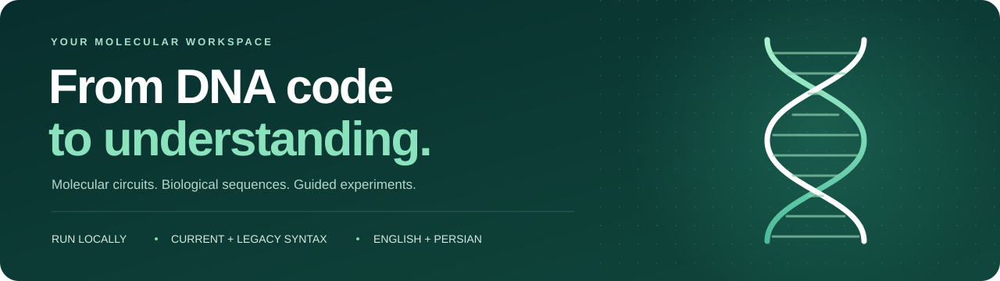
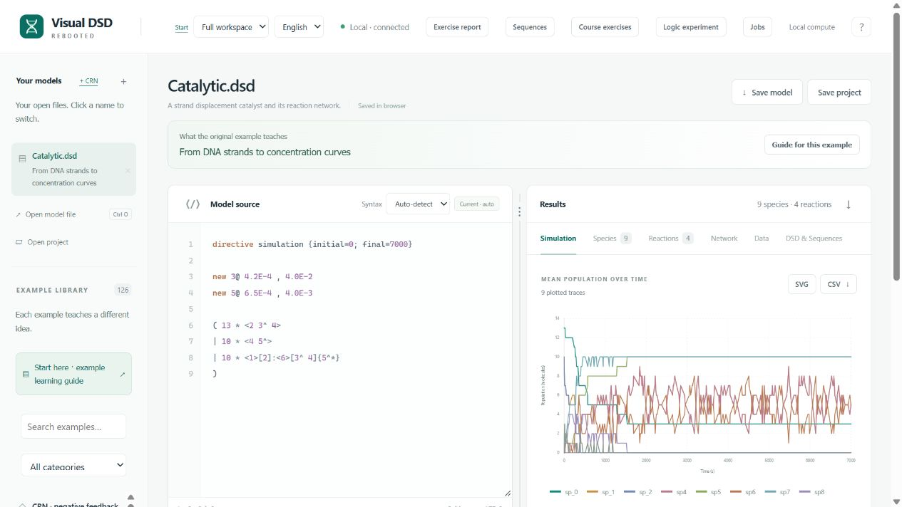
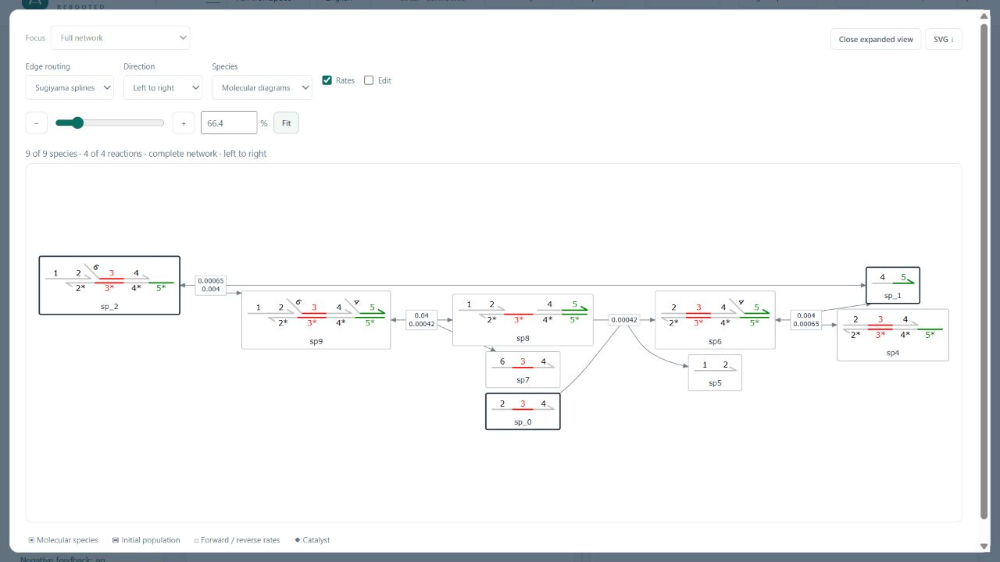
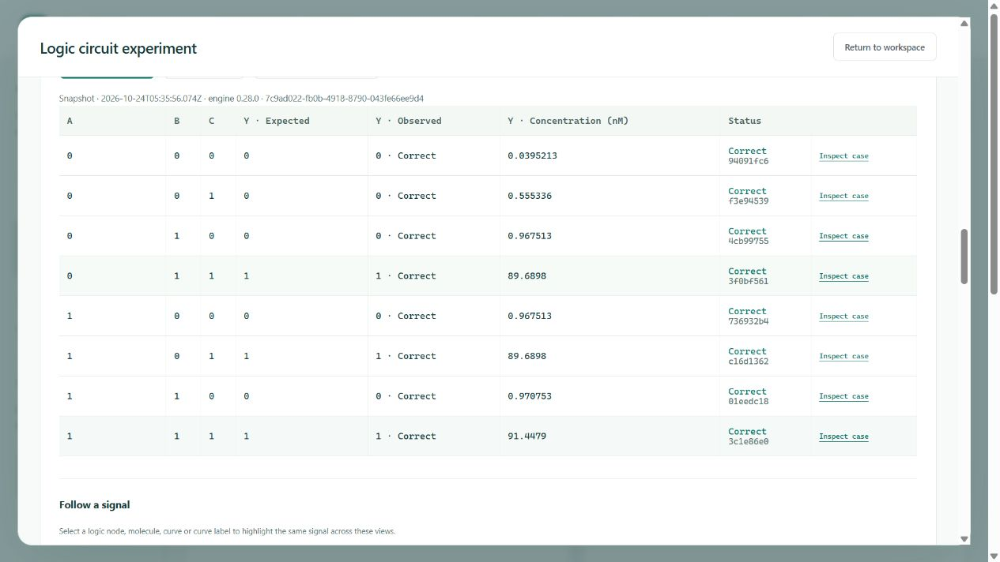
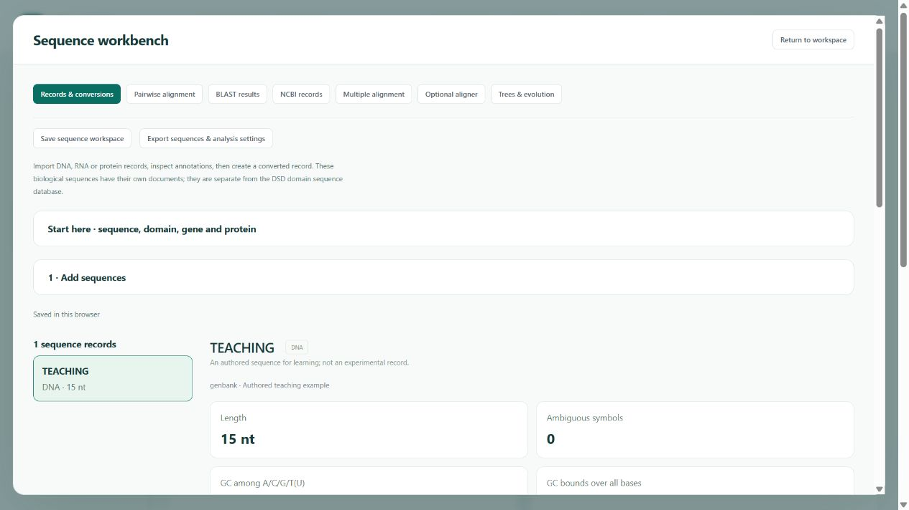
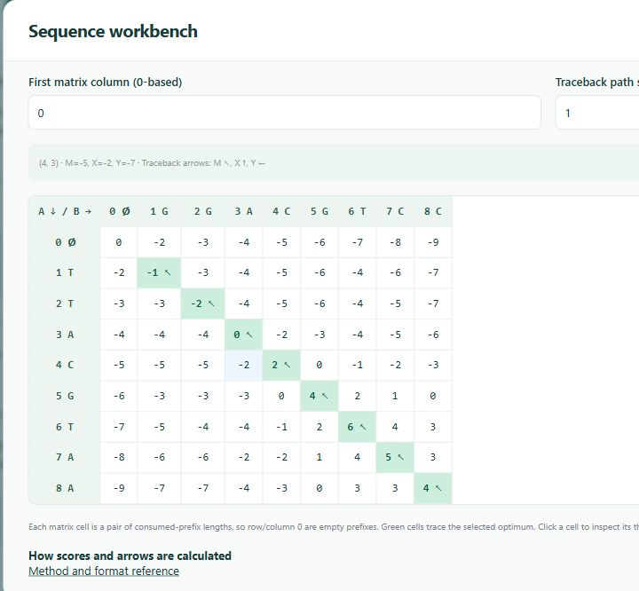
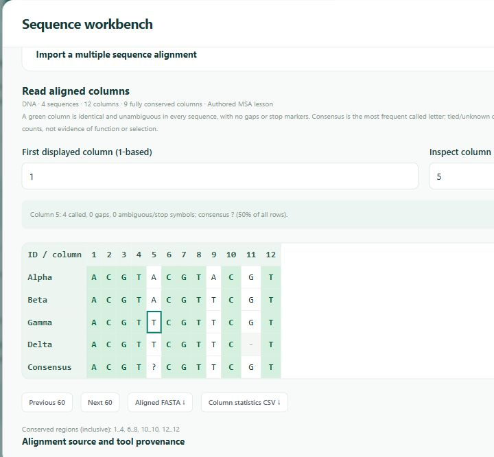
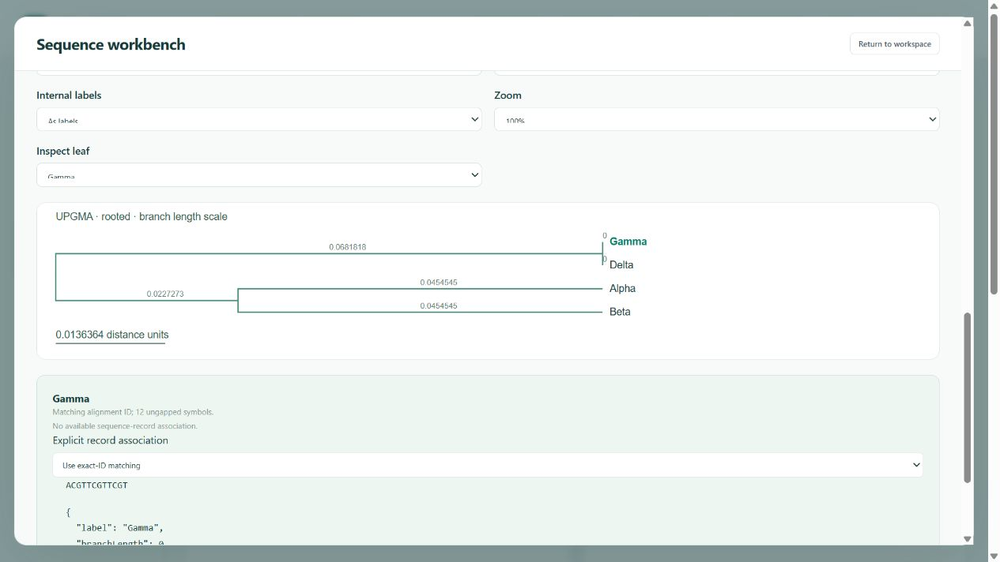
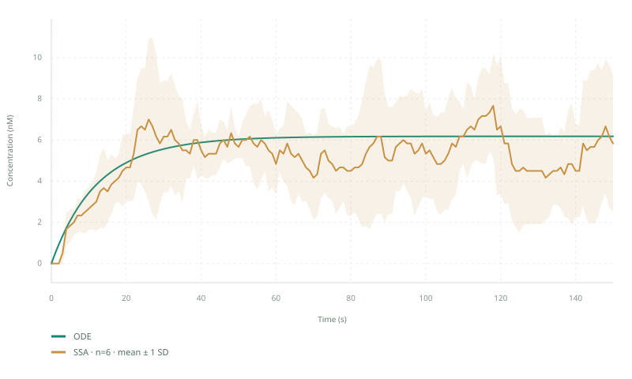
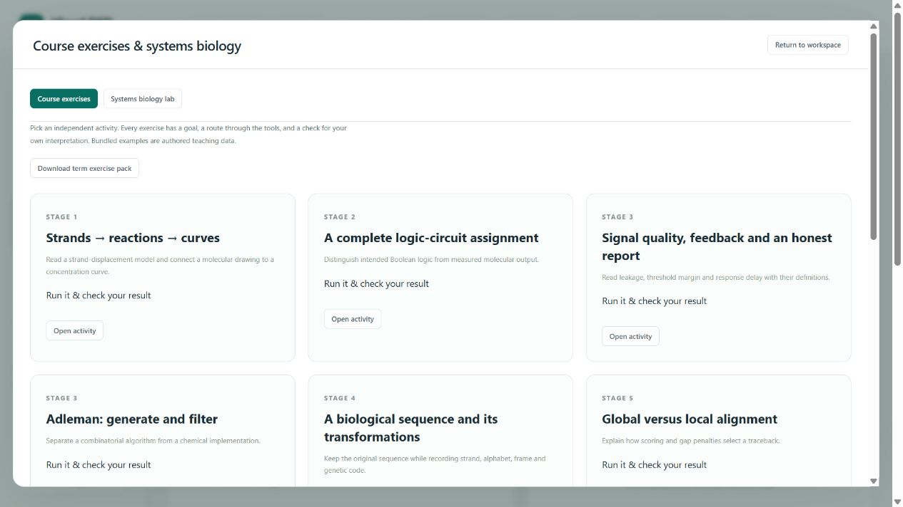

<div align="center">

# Visual DSD Rebooted

**DNA strand displacement. Biological sequences. Reproducible experiments.**

[](https://github.com/parhamKIY/Visual-DSD-rebooted/actions/runs/40064995895) [](https://github.com/parhamKIY/Visual-DSD-rebooted/releases/tag/v0.28.0) [](#download) [](LICENSE)



<br>

<a href="https://github.com/parhamKIY/Visual-DSD-rebooted/releases/download/v0.28.0/visual-dsd-rebooted-win-x64-v0.28.0.zip"></a> <a href="https://github.com/parhamKIY/Visual-DSD-rebooted/releases/download/v0.28.0/visual-dsd-rebooted-linux-x64-v0.28.0.zip"></a>

**Looking for the Windows EXE? Download the ZIP above → extract it → open `VisualDsd.exe`.**

No SDK. No Node.js. No account needed to run the app.

[Download & first launch](#download) · [See it in action](#see-it-in-action) · [Course exercises](#built-for-learning) · [Technical guide](docs/WORKSPACE-GUIDE.md)

</div>

---

**Visual DSD Rebooted** brings the original Visual DSD language and scientific core into a modern, self-contained desktop app. Write DNA programs, inspect molecular reaction networks, run simulations, and explore sequence analysis — all from a browser workspace served by your own computer.

It started with a classroom problem: *take a logic circuit through the Seesaw Compiler, open the generated DSD, and understand what happens.* The result is a workspace that keeps that assignment approachable, with tools for the sequence-analysis and systems-biology work that comes next.

[](docs/assets/screenshots/workspace.png)

*The built-in catalytic example, running in the released app. All interface screenshots below show actual application output; example datasets and teaching models are illustrative.*

## Download

### Windows — download, extract, open

1. **[Download Visual DSD Rebooted for Windows x64](https://github.com/parhamKIY/Visual-DSD-rebooted/releases/download/v0.28.0/visual-dsd-rebooted-win-x64-v0.28.0.zip).**
2. Right-click the downloaded ZIP and choose **Extract All**. Open the extracted folder.
3. Double-click **`VisualDsd.exe`**. Keep the accompanying files with the app.
4. Your browser opens at **`http://127.0.0.1:5800`**. Choose **Course exercises**, or open your own model.
5. Run an example and use **Save project** to keep the source, settings and saved results.

The EXE is **inside the ZIP**, not a separate installer. You do not need to build the project or install development tools. The app process must stay running while you use the workspace.

| Download | What you get | Verify |
| --- | --- | --- |
| **[Windows x64 · ZIP with EXE](https://github.com/parhamKIY/Visual-DSD-rebooted/releases/download/v0.28.0/visual-dsd-rebooted-win-x64-v0.28.0.zip)** | `VisualDsd.exe`, example models, bilingual first-run guides and the course pack | [SHA-256](https://github.com/parhamKIY/Visual-DSD-rebooted/releases/download/v0.28.0/visual-dsd-rebooted-win-x64-v0.28.0.zip.sha256) |
| **[Linux x64 · portable ZIP](https://github.com/parhamKIY/Visual-DSD-rebooted/releases/download/v0.28.0/visual-dsd-rebooted-linux-x64-v0.28.0.zip)** | Self-contained `VisualDsd` executable and the same learning material | [SHA-256](https://github.com/parhamKIY/Visual-DSD-rebooted/releases/download/v0.28.0/visual-dsd-rebooted-linux-x64-v0.28.0.zip.sha256) |
| [All releases & release notes](https://github.com/parhamKIY/Visual-DSD-rebooted/releases) | Published versions for both platforms | Each release includes checksums |

<details>
<summary><strong>Linux launch instructions</strong></summary>

Extract the ZIP, open a terminal in the extracted folder, then run:

```bash
chmod +x VisualDsd
./VisualDsd
```

Linux requires the operating system's [native .NET dependencies](https://learn.microsoft.com/en-us/dotnet/core/install/linux); a separate .NET runtime installation is not required.

</details>

<details>
<summary><strong>The browser did not open, or port 5800 is occupied?</strong></summary>

Keep the application running and open `http://127.0.0.1:5800` yourself. To choose another port:

```powershell
# Windows, from the extracted application folder
.\VisualDsd.exe serve --port 5801
```

```bash
# Linux
./VisualDsd serve --port 5801
```

Then open `http://127.0.0.1:5801`. A different address/port has separate browser storage. Save a project before moving your work between them.

</details>

**First-run guides:** [English](distribution/START-HERE.en.md) · [فارسی](distribution/START-HERE.fa.md)

## See it in action

Click a screenshot to open it at full size.

### Read the molecules, not just the node names

Generate a complete reaction network with **molecular strand diagrams**, domain colors, decimal rate labels and layered edge routing. Pan, zoom, change direction, inspect species, and export a vector SVG. Both current and old Visual DSD syntax are supported, with the original converter's documented limits.

[](docs/assets/screenshots/molecular-network.png)

### Turn a Seesaw assignment into a reproducible experiment

Import the compiler's generated DSD, map the molecular inputs and outputs, define OFF/ON concentrations and thresholds, then run every input case. Inspect the **truth table, concentration curves, leakage, threshold margin and response delay**. Unknown outcomes and failed calculations stay visible.

[](docs/assets/screenshots/logic-experiment.png)

Expected Boolean logic and measured molecular behavior are recorded separately. The app accepts **Seesaw-generated Visual DSD**; it does not bundle the Seesaw Compiler or directly execute its uncompiled netlists.

### Follow a sequence from letters to an explanation

Import **FASTA or GenBank**, inspect annotations, keep the original record, and record each reverse complement, transcription or translation. For short pairwise examples, see the **global/local alignment matrix and traceback**, change gap penalties, and inspect tied optimal paths.

| Biological sequence workbench | Pairwise alignment you can follow |
| --- | --- |
| [](docs/assets/screenshots/sequences.png) | [](docs/assets/screenshots/alignment.png) |

Read imported **BLAST** tables with explicit coverage and E-value definitions. Optional NCBI retrieval keeps accession/version and source metadata. Local lessons work offline; database retrieval needs internet.

### Connect an alignment to a tree — and keep the assumptions

Read aligned FASTA or CLUSTAL, inspect **conserved columns and consensus**, then compare **UPGMA and Neighbor Joining** with recorded distance models, deletion rules and site counts. Import/export Newick, link tree leaves to sequence records, and inspect the actual branch lengths.

| Multiple alignment & conservation | Tree construction & inspection |
| --- | --- |
| [](docs/assets/screenshots/multiple-alignment.png) | [](docs/assets/screenshots/evolution.png) |

Native **MUSCLE 5** is an optional, separately installed aligner. The core app and alignment viewer work without it. A distance tree does not create bootstrap support or establish evolutionary certainty.

### See what a single stochastic curve leaves out

Three systems-biology labs explore **conserved conversion, promoter switching with gene expression, and negative autoregulation**. Compare a deterministic trajectory with separately seeded SSA repeats. Inspect individual paths, ensemble mean and sample SD, endpoint statistics, conservation checks and every run's state.

[](docs/assets/screenshots/systems-biology.png)

*Plot exported directly from the app; click it for the full workspace screenshot.*

The models and rates are illustrative. The SD band describes variation across completed repeats; it is not a confidence interval. Equations, scaling assumptions and interpretation questions sit beside each lesson.

## Built for learning

**Eleven independent guided activities** connect molecular computing, sequence analysis, evolution and systems biology. Each has a goal, an input, a route through the tools, and something concrete to check.

[](docs/assets/screenshots/course-exercises.png)

| Start with… | Then explore… | Keep your evidence |
| --- | --- | --- |
| A strand-displacement example | Species, reactions, molecular network and curves | Source + saved project |
| A Seesaw logic circuit | All input cases, readout rules and condition comparisons | Truth table + trajectories + interpretation |
| DNA, RNA or protein records | Transformations, translation, alignment and search | Original records + derived sequences + settings |
| An aligned set of sequences | Conserved sites, distances and tree assumptions | Alignment + distance matrix + Newick |
| A systems-biology lesson | Deterministic behavior, stochastic repeats and feedback | Seeds + requests + CSV + your notes |

- **English by default, Persian when you choose it.** Guided activities and reports offer both languages.
- **A portable course pack.** The release includes printable English/Persian workbooks, authored sequence/alignment/tree examples and four editable CRN models under `course/`.
- **Reports with your interpretation.** Export printable HTML or a ZIP with source, settings, actual recorded data and vector plots. Write the conclusion yourself.
- **A separate Adleman lab.** Follow bounded candidate generation and filtering on a small graph, with the algorithm's assumptions visible.

## More depth when you need it

Switch to **Full workspace** to reach the scientific tools without losing your source or settings.

| Area | Included tools |
| --- | --- |
| Languages & compilation | Current/legacy DSD, Rules DSD, editable CRNs, multiple systems, parameter sweeps, default/detailed/finite/infinite compilation |
| Simulation | Oslo, SSA, JIT SSA, LNA, CME, Sundials/CMESundials, moment closure and bounded 1D/2D reaction–diffusion |
| Inference & synthesis | Seeded multichain MCMC, observation CSV, linked model fits, Z3 multistability and Turing synthesis |
| Exploration | State graphs, probability distributions, phase trajectories, Jacobian graphs and dispersion curves |
| Scientific exports | Model-appropriate CRN, SBML, MATLAB/Octave, LaTeX, CSV, JSON and SVG |
| Long calculations | Isolated worker processes, explicit cancellation, durable job history, reconnect and optional authenticated remote compute |

[Read the full workspace & technical guide →](docs/WORKSPACE-GUIDE.md)

## What the checks establish

The preserved original-source reference and rebooted engine are checked against **300 recorded reference cases**. The public-output comparison covers **287 successful networks and 13 explicitly retained unsupported outcomes**, with **20 original-reference trajectories**. Published application packages are checked on Windows and Linux before release.

The additional teaching tools have independent alignment/tree reference checks, analytic and SciPy checks for the systems models, project round trips, and packaged-application tests. [Inspect the verification workflow](https://github.com/parhamKIY/Visual-DSD-rebooted/actions/workflows/engine.yml) or read the [compatibility details](docs/WORKSPACE-GUIDE.md#compatibility--scope).

These are software and numerical checks, not experimental validation or a promise of complete original-tool parity. Classroom usability evaluation is still pending. NGS/RNA-seq pipelines, proteomics and structure prediction are outside this release's course pack.

## Develop & contribute

The application is built with **.NET 10**, the **F# scientific core**, a **C# host**, and a web interface using native JavaScript modules. Downloaded builds include their runtime and assets; the developer requirements below are only for working on the source.

```powershell
git clone https://github.com/parhamKIY/Visual-DSD-rebooted.git
cd Visual-DSD-rebooted

# Windows: install the pinned SDK locally if needed.
pwsh ./eng/bootstrap.ps1
pwsh ./eng/run.ps1
```

For Linux prerequisites, native solvers, tests, command-line use and release packaging, see the [development guide](docs/WORKSPACE-GUIDE.md#build--test).

Found a problem? [Open an issue](https://github.com/parhamKIY/Visual-DSD-rebooted/issues/new) with the app version, platform, a minimal reproducible model and the actual diagnostic. Include relevant settings and seeds; remove any data you do not want to publish.

## Origins & license

Built on Microsoft's original [CRN Engine / Visual DSD](https://github.com/microsoft/CRN), with its source preserved for comparison and regression testing. This is an independent modernization and educational extension.

Distributed under [MIT](LICENSE), with original copyright and third-party acknowledgements in [NOTICE](NOTICE). The optional MUSCLE tool has its own license and is not bundled.

---

<div align="center">

**Ready to try it? Your first model is a download away.**

[Download Windows app](https://github.com/parhamKIY/Visual-DSD-rebooted/releases/download/v0.28.0/visual-dsd-rebooted-win-x64-v0.28.0.zip) · [Download Linux app](https://github.com/parhamKIY/Visual-DSD-rebooted/releases/download/v0.28.0/visual-dsd-rebooted-linux-x64-v0.28.0.zip) · [Release notes](https://github.com/parhamKIY/Visual-DSD-rebooted/releases/tag/v0.28.0)

</div>
